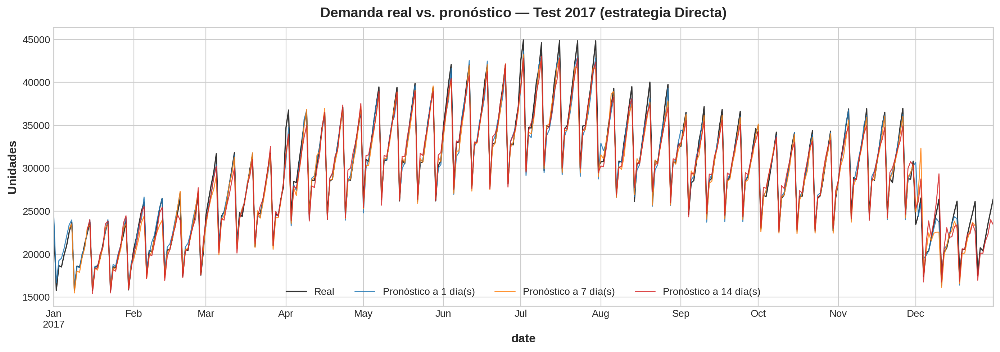
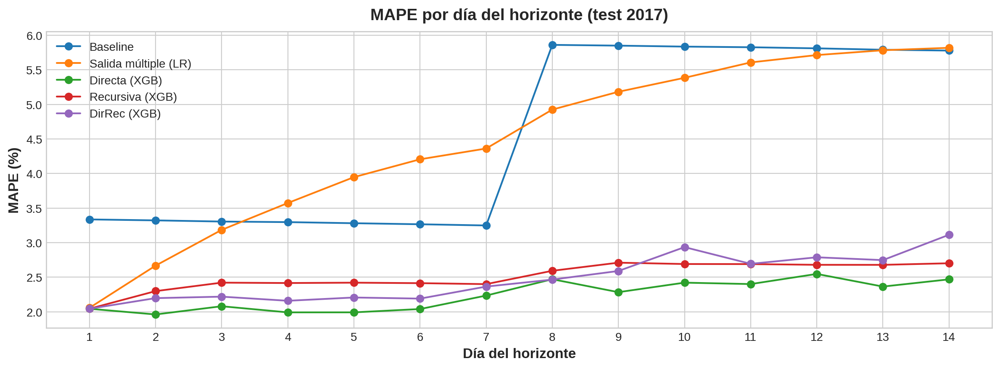

# Pronóstico de Demanda Multipaso con Machine Learning

Modelo que pronostica la demanda diaria de una cadena retail (10 tiendas, 50 productos) para los **próximos 14 días**, comparando 4 estrategias de forecasting multipaso con XGBoost.



## Problema
La reposición se planifica repitiendo lo vendido la semana anterior. Si se pronostica de menos hay quiebres de stock, y si se pronostica de más se acumula inventario. Este modelo anticipa la demanda de las próximas dos semanas, que es el ciclo típico de reposición.

## Datos
- **Fuente:** [Store Item Demand Forecasting Challenge – Kaggle](https://www.kaggle.com/competitions/demand-forecasting-kernels-only/data)
- **Volumen:** 913,000 registros diarios (2013–2017), 500 series tienda-producto, sin nulos
- **Validación:** 2013–2016 para entrenar y 2017 completo como prueba (352 orígenes × 14 días)

## Resultados (test 2017)

| Estrategia | MAE (unid.) | MAPE | R² |
|---|---:|---:|---:|
| **Directa (XGBoost)** ✅ | 659 | **2.24 %** | 0.979 |
| DirRec (XGBoost) | 733 | 2.48 % | 0.974 |
| Recursiva (XGBoost) | 724 | 2.51 % | 0.973 |
| Salida múltiple (Regresión Lineal) | 1,228 | 4.46 % | 0.932 |
| Baseline (repetir semana anterior) | 1,271 | 4.56 % | 0.870 |

**Conclusiones clave**
- La estrategia **Directa reduce el error a menos de la mitad** frente al baseline (−2.3 puntos de MAPE).
- Su error se mantiene **estable del día 1 al 14** (2.0–2.6 %). En las estrategias Recursiva y DirRec el error crece con el horizonte (efecto bola de nieve).
- La variable más importante es la **demanda del mismo día de la semana anterior** (lag 7), lo que coincide con el EDA: el domingo vende un 50 % más que el lunes.



## Metodología
1. **EDA:** tendencia, estacionalidad semanal y anual, descomposición, periodograma y PACF.
2. **Features:** 14 lags + día de la semana + Fourier anual + tendencia.
3. **Modelado:** Salida múltiple, Directa (`MultiOutputRegressor`), Recursiva (manual y con `skforecast`) y DirRec (`RegressorChain`).
4. **Evaluación:** MAE, RMSE, MAPE y R², error por horizonte, `RandomizedSearchCV` con `TimeSeriesSplit` e importancia de variables.
5. **Despliegue:** propuesta de pipeline batch diario, con el modelo guardado en `joblib` y una función de predicción.

## Herramientas
Python · Pandas · NumPy · Scikit-learn · XGBoost · skforecast · Statsmodels · SciPy · Matplotlib · Seaborn

## Estructura
```
├── notebooks/
│   └── demand_forecasting_multistep.ipynb
├── reports/
│   ├── figures/                 # gráficos del análisis
│   ├── strategy_comparison.csv
│   └── forecast_2018.csv
└── requirements.txt
```

## Cómo ejecutarlo
1. Abre `notebooks/demand_forecasting_multistep.ipynb` en Google Colab o Jupyter.
2. Instala las dependencias con `pip install -r requirements.txt`.
3. El notebook descarga los datos automáticamente. También puedes bajar `train.csv` de Kaggle y ponerlo junto al notebook.

---
**Diego Yeferson Quispe Huamani** · Estudiante de Big Data y Ciencia de Datos – Tecsup
[LinkedIn](https://www.linkedin.com/in/di-yeferson) · [GitHub](https://github.com/di-yeferson)
